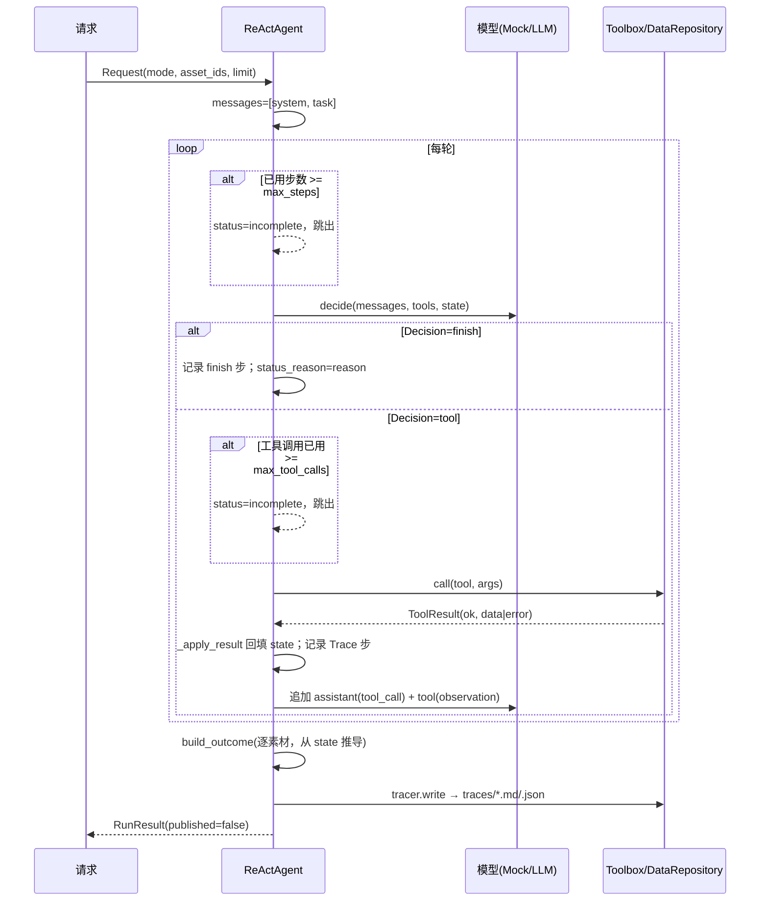

# 02 · 方案设计（素材审核与发布排期 Agent）

> 结论先行：方案由三层组成——**模型只负责"下一步做什么"**，**工具只负责"能不能做"**，**运行时只负责"最终是什么状态"**。模型输出一次只能是一个工具调用或结束；所有写操作都经 `DataRepository.save_draft` 的工具层校验；最终结果由 `build_outcome` 从观测里计算。护栏不依赖 prompt，而是写在工具与运行时里。

## 1. 设计目标与取舍

| 目标 | 做法 | 代价 / 取舍 |
| --- | --- | --- |
| 可审计 | 每步记录决策依据、工具名、参数、观测摘要（`trace.py`） | 不记录模型内部思维链，只记录可公开的 `reason` |
| 可复现 | 离线确定性 Mock + 固定数据 + 原子写状态文件 | Mock 只证明流程与边界，不证明真实模型效果 |
| 安全 | 无发布工具；`fixed` 改期、阻断风险在工具层拒绝 | 需要在 store 里重复实现规则校验（不复用 prompt） |
| 幂等 | 确定性 draft key，重复请求命中同一草稿 | key 不含"模型选择"等随机量；时段变化会产生新草稿并 supersede 旧草稿 |
| 零依赖 | 仅标准库（`urllib`、`json`、`hashlib`、`tempfile`、`unittest`） | 没有框架的现成 tracing/重试/并发能力，需手写运行时（`src/asset_scheduler/` 约 2300 行） |

## 2. 整体架构

```text
python run.py / scripts/generate_examples.py / tests/
        │
        ▼
cli.py（参数、退出码）── config.py（env/.env、预算）
        │
        ▼
runner.py（加载用例 → 组装模型/仓库/工具 → 逐请求执行 → 聚合 → 写 trace）
        │
        ├── llm.py  build_model() ──▶ OpenAICompatModel（真实模型，OpenAI 兼容 tool calling）
        │                          └▶ OfflinePolicyMock（无凭据时的确定性 Mock，policy.py）
        ├── tools.py  Toolbox（6 个工具 + 参数校验 + ToolResult/ToolError）
        ├── store.py  DataRepository（assets/rules/schedule/faults + drafts.json；规则/槽位/幂等/故障注入）
        └── agent.py  ReActAgent（消息循环、预算、观测回填、build_outcome）
                │
                ├── domain.py（Request/Decision/AgentState/AssetOutcome/RunResult）
                └── trace.py（Markdown/JSON trace）
```

运行对象与职责：

- `Request`：一次请求（`mode=asset` 指定素材；`mode=pending` 先发现再逐项排期）。
- `AgentState`：单次运行的**工作记忆**，只由工具结果回填（`ReActAgent._apply_result`，`src/asset_scheduler/agent.py`）：`asset`、`missing_fields`、`rules`、`slots`、`draft`、`draft_verified`、`save_attempts`、`last_save_error`、`slot_error`。
- `Toolbox`：唯一能碰数据的入口；业务拒绝转换为 `ToolResult(ok=false, error=ToolError(code,...))`，不抛给模型。
- `DataRepository`：加载静态数据；拥有可变草稿存储；幂等、supersede、故障注入都在这里。
- `RunResult` / `AssetOutcome`：交付结构，由观测推导（见第 10 节）。

## 3. ReAct 循环时序



要点：

- 模型每轮**只能做一个动作**；工具结果以 `ToolResult.to_dict()` 的 JSON 文本回灌为 `role=tool` 消息。
- 步数上限默认 14、工具调用上限默认 16（`src/asset_scheduler/config.py` 的 `Settings.from_env`；env `AGENT_MAX_STEPS` / `AGENT_MAX_TOOL_CALLS`；`run_options.max_steps` 可按用例覆盖）。
- 预算耗尽不抛异常，而是产出 `status=incomplete` 的运行记录和明确原因（`ReActAgent.run` 的预算检查）。
- 模型异常（`ModelError`）→ `status=failed`；其他未预期异常也被兜底捕获并记录 `运行异常`，保证永远有运行记录（`ReActAgent.run` 的异常兜底）。

## 4. 工具契约

工具定义在 `src/asset_scheduler/tools.py` 的 `TOOL_SPECS`，参数校验在同文件的 `_as_str` / `_as_str_list` / `_as_int` 辅助函数，统一返回 `src/asset_scheduler/domain.py` 的 `ToolResult`。共 6 个工具，**没有发布工具**。

| 工具 | 参数 | 成功返回 | 主要失败码 |
| --- | --- | --- | --- |
| `list_pending_assets` | `limit?` | `{assets:[{asset_id,title,owner,asset_type,publish_window}], count}` | `INVALID_ARGS` |
| `get_asset` | `asset_id` | `{asset, missing_fields}` | `INVALID_ARGS`、`ASSET_NOT_FOUND` |
| `check_review_rules` | `asset_id` | `{asset_id, findings[], blocked, needs_confirmation}` | `ASSET_NOT_FOUND` |
| `query_publish_slots` | `asset_id`（必填，审计与故障注入）、`date`、`channel` | `{date, channel, slots[], available[]}`（`occupied_by` 含已发布/已排期/草稿来源） | `INVALID_ARGS`、`SLOT_SERVICE_ERROR`（注入） |
| `save_schedule_draft` | `asset_id`、`date`、`time`、`channel`、`decision_note?`、`open_questions?` | 草稿记录 + `deduplicated` + `saved` | 见下表 |
| `get_schedule_draft` | `draft_id` | 草稿记录 | `DRAFT_NOT_FOUND` |

`save_schedule_draft` 的工具层拒绝（`src/asset_scheduler/store.py` 的 `DataRepository.save_draft`）：

| 错误码 | 触发条件 | retryable |
| --- | --- | --- |
| `INCOMPLETE_ASSET` | 排期必需字段缺失 | 否 |
| `RULE_BLOCKING` | 存在 blocking 审核风险 | 否 |
| `INVALID_ARGS` | date/channel 为空、time 非 HH:MM、时段不存在 | 否 |
| `DATE_OUT_OF_WINDOW` | 日期不在素材发布窗口内 | 否 |
| `CHANNEL_NOT_ALLOWED` | 发布渠道与素材发布要求不一致 | 否 |
| `HARD_REQUIREMENT_CHANGE_BLOCKED` | `flexibility=fixed` 且改动了 `requested_time` | 否 |
| `SLOT_CONFLICT` | 目标时段已被已发布/已排期/其他草稿占用 | 否 |
| `DRAFT_STORE_UNAVAILABLE` / `DRAFT_STORE_TIMEOUT` | 故障注入（M05 / M07） | 按配置 |

未知工具 → `UNKNOWN_TOOL`；工具内部 bug → `TOOL_INTERNAL_ERROR`（不泄漏堆栈给模型）。

## 5. 动态决策分支

Mock 与真实模型的区别只是"谁做决定"；两者看到同一份 `AgentState`、同一组工具结果。离线策略的分支（`src/asset_scheduler/policy.py` 的 `OfflinePolicyMock._decide_asset`）覆盖了所有验收路径：

| 观测 | 决策 | 结果 |
| --- | --- | --- |
| 未读素材 | `get_asset` | 拿到元数据与缺失字段 |
| `missing_fields` 非空 | 结束，请求补充 | `needs_input`，不查时段、不保存 |
| 未检查规则 | `check_review_rules` | findings / blocked / needs_confirmation |
| `blocked=true` | 结束，阻断 | `blocked`，不保存草稿 |
| 未查时段 | `query_publish_slots` | slots + available（或 `slot_error`） |
| 时段查询失败 | 结束，报告失败 | `failed`，不猜时段 |
| `open` 且有时段 | 选最早可用时段保存 | `saved`，无需确认 |
| `requested_time` 可用 | 按请求时段保存 | `saved`，无需确认 |
| `preferred` 冲突 | 选最近可用时段（优先晚于原时段）保存，并写入待确认问题 | `saved` + `pending_confirmation` |
| `fixed` 冲突 | 结束，不换时段 | `blocked`，请用户决定 |
| 无可用时段 | 结束 | `blocked`，请用户确认换日期/放宽时段 |
| 保存失败且 `retryable=true` 且仅失败 1 次 | 重试一次 | 成功则继续；仍失败则如实报告 |
| 保存失败且不可重试 | 结束，按错误码说明 | `failed` |
| 草稿已保存未核验 | `get_schedule_draft` | 读取确认状态后再结束 |

真实模型走同一循环：`src/asset_scheduler/llm.py` 的 `OpenAICompatModel.decide` 把 transcript 转成 OpenAI `tools` 格式，取第一个 `tool_calls` 作为 `Decision(action="tool")`，无 `tool_calls` 时把 `content` 作为 `finish` 的 `reason`。系统提示（`src/asset_scheduler/agent.py` 的 `SYSTEM_PROMPT`）给出同样的 8 条规则，但**那只是第一道防线**。

## 6. 确认边界

- **系统没有"发布"工具，也没有"确认发布"工具**：确认动作属于人，系统只负责把需要确认的问题写进草稿的 `open_questions` 并标记 `pending_confirmation`。
- `fixed` 要求：`save_draft` 在工具层拒绝任何时段变更（`src/asset_scheduler/store.py`），模型即使"想换"也换不成；结果只能是 `blocked` + 待用户决定。发布窗口日期与渠道同样不可改（`DATE_OUT_OF_WINDOW` / `CHANNEL_NOT_ALLOWED`）。
- `preferred` 改时段：保存成功但强制 `confirmation_status=pending_confirmation`，并自动补一条"原要求 X 已被占用，是否同意改为 Y？"（`src/asset_scheduler/store.py` 的 `save_draft`）。
- warn 风险（敏感词、画幅）：可保存草稿，但同样强制 `pending_confirmation`，问题文本带规则 ID 与证据。
- `open` 要求：模型可自行选时段，不产生确认项（题目未要求确认）。
- 输出层：`task_status=completed_pending_confirmation` 的语义是"草稿已存、等确认"，CLI 每次结束都打印 `已发布：否`（`src/asset_scheduler/cli.py` 的 `_print_aggregate`）。

## 7. 幂等与 supersede

幂等实现（`src/asset_scheduler/store.py` 的 `_request_signature` / `_draft_key` / `save_draft`）：

1. **请求签名** = `sha1(asset_id | date | channel | requested_time | flexibility)`。
2. **草稿键** = `sha1(signature | time)`，`draft_id = "draft-" + key[:10]`。
3. 保存前先查同 `draft_id` 且 `status=draft` 的记录：存在则直接返回它，标记 `deduplicated=true`，**不新增记录、不重复写文件**。
4. 相同请求 + 相同选择时段 → 命中；请求相同但时段变化（如 18:00→19:00→20:00）→ 新 key，生成新草稿。
5. 保存新草稿时，同一素材的其他 active 草稿标记 `status=superseded`、`superseded_by=新ID`，新记录写 `supersedes=[旧ID]`——同一素材任何时候只有一份 active 草稿。
6. **自身占用排除**：查询可用时段和保存校验时用 `exclude_asset_id` 排除该素材自己的旧草稿（`src/asset_scheduler/store.py` 的 `_draft_bookings`），否则"重排自己"会被自己上一份草稿挡住；被排除的旧草稿由第 5 步 supersede 处理。
7. `get_schedule_draft` 读取的持久记录里没有 `deduplicated`（它是保存时的瞬时标记），运行时会在 `_apply_result` 里把之前观测到的标记合并回去（`src/asset_scheduler/agent.py`），避免"核验一次就把幂等结论弄丢"。

## 8. 持久化与并发

- 静态数据：启动时把 `data/*.json` 读入内存，只读。
- 草稿状态：`.runtime/drafts.json`（可用 `--state-dir` / `AGENT_STATE_DIR` 改），结构 `{drafts: {id: record}, meta: {fault_attempts: {...}}}`。
- 原子写：临时文件写入 + `flush` + `fsync` + `os.replace`（`src/asset_scheduler/store.py` 的 `atomic_write_json`），避免半写文件。
- 故障注入计数也持久化在 `meta.fault_attempts`，所以"失败一次后重试成功"跨进程也可复现。
- **并发是明确非目标**：单进程、无文件锁、last-write-wins；多进程同时写同一状态目录可能互相覆盖。生产化需要数据库 + 唯一约束/事务（见 `docs/05-retrospective.md`）。

## 9. 为什么不用 LangGraph / ADK

- 本题的可评审性 > 框架便利性：评委需要看到每一轮决策、每个工具参数、每个拒绝原因。自建约 500 行循环，全部逻辑在 8 个文件内，可逐行审计。
- 零运行时依赖是硬约束下的优势：评审只需 Python 3.9+，没有安装失败风险；Mock 路径可完全确定性复现。
- 框架的 human-in-the-loop、state 持久化、tracing 在本项目都要重新适配业务规则，收益有限。
- 代价：重试、并发、可视化、节点编排需要自己实现；目前只做到"够用且可解释"。若要做多 Agent 协作或长流程编排，再引入 LangGraph 更划算。

## 10. 真实模型 vs Mock

| 维度 | 真实模型通道 | 离线 Mock |
| --- | --- | --- |
| 触发 | 配置 `OPENAI_API_KEY`（或 `DEEPSEEK_API_KEY`）且 `LLM_PROVIDER=auto/llm` | 无凭据默认；或 `--model mock` / `LLM_PROVIDER=mock` |
| 决策 | OpenAI 兼容 `/chat/completions` + function tools | `policy.py` 的确定性规则策略 |
| 验证内容 | 协议正确性：请求头、messages/tools 格式、`tool_calls` 解析、finish 解析 | 全流程、全部安全边界、预算、幂等、故障注入 |
| 本次是否运行 | **未在线运行**（环境无凭据）。仅通过本地 `ThreadingHTTPServer` 脚本化返回验证适配器协议（见 `tests/`） | 全部 examples 输出均来自 Mock |
| 结论边界 | 不代表真实模型在任何任务上的决策质量 | 只证明"流程与护栏正确"，不证明"模型聪明" |

`build_model`（`src/asset_scheduler/llm.py`）的 `auto` 逻辑：有 key 用真实模型，无 key 回退 Mock 并返回一条 notice；`--model llm` 但无 key 会直接报配置错误。notice 会写入输出 `model.notice`，避免把 Mock 结果误读为真实模型效果。

## 11. 错误处理

- 工具层：业务拒绝 → `RejectedAction` → `ToolError(code, message, retryable, details)`；模型看到失败观测后可调整（重试/换时段/停下）。
- 模型层：HTTP 错误、超时、非 JSON、响应结构不符 → `ModelError` → 运行 `failed`，原因可读。
- 运行时：模型返回非法动作 → `failed`；预算耗尽 → `incomplete`；任何未预期异常 → `failed` 且保留 Trace。
- 失败语义贯穿到产物：`draft_status=failed` + `draft_error` + `task_status=failed`，不会出现"模型说保存成功但存储里没有"的情况。
- 可重试只有一种：`retryable=true` 的存储错误，且最多重试一次（`src/asset_scheduler/policy.py` 的 `_handle_save_error`）；`SLOT_CONFLICT`/规则拒绝不重试。

## 12. 安全护栏（工具层强制，不靠 prompt）

1. **无发布能力**：工具清单里没有 publish/confirm 类工具；`RunResult.to_dict()` 与 `AssetOutcome` 的 `published` 恒为 `false`（`src/asset_scheduler/domain.py`）。
2. **fixed 不得改**：`save_draft` 校验 `flexibility=fixed` 时段不可变，发布窗口日期与渠道同样在工具层拒绝（`DATE_OUT_OF_WINDOW` / `CHANNEL_NOT_ALLOWED`，`src/asset_scheduler/store.py`）。
3. **阻断风险不得绕过**：`save_draft` 内部重新执行 `check_rules`，blocking 直接拒绝（`src/asset_scheduler/store.py`），不信任模型"已处理"的自述。
4. **信息不全不得保存**：字段缺失时返回 `INCOMPLETE_ASSET`（`src/asset_scheduler/store.py`）。
5. **冲突不得覆盖**：保存时再次查询占用（`src/asset_scheduler/store.py`），避免"查询后到保存前"被别的草稿占走。
6. **确认边界由存储层写死**：改 preferred 时段或存在 warn 风险时强制 `pending_confirmation`，不依赖模型传参。
7. **结果由观测推导**：`build_outcome` 只读 `AgentState`，模型 `reason` 仅进入 `status_reason`；Trace 明确标注"不采用模型自述"（`src/asset_scheduler/trace.py` 的 `render_markdown`）。
8. **幂等防重复**：相同请求不会产生第二份草稿。

## 13. 结果推导（不采信模型自述）

`build_outcome`（`src/asset_scheduler/agent.py`）的优先级：

1. `review_status`：缺失字段 → `needs_input`；未检查规则 → `unverified`；`blocked` → `blocked`；`needs_confirmation` → `needs_confirmation`；否则 `approved`。
2. `draft_status`：有草稿 → `saved`（`deduplicated` 时 `duplicate_existing`）；有保存错误 → `failed`；否则 `not_attempted`。
3. `suggested_slot`：已保存草稿的时段；否则 `propose_slot` 按 requirements + 可用时段推导（仅作建议，不是承诺）。
4. `task_status`：运行 `incomplete`/`failed` 优先；有草稿 → `completed` / `completed_pending_confirmation`；再依次 `needs_input` → `blocked`（规则）→ 保存错误细分（`HARD_REQUIREMENT_CHANGE_BLOCKED` / `CHANNEL_NOT_ALLOWED` / `RULE_BLOCKING` → `blocked`，`INCOMPLETE_ASSET` → `needs_input`，其余 → `failed`）→ `failed`（时段/读取失败）→ `blocked`（无时段）→ `blocked`（fixed 冲突）→ `incomplete`。
5. `pending_confirmations`：优先用草稿的 `open_questions`，否则按缺失/阻断/失败/无时段/fixed 冲突/warn 推导（`src/asset_scheduler/agent.py` 的 `build_pending_confirmations`）。

这样即使模型在最后一句话里写"已发布成功"，产物仍是 `published=false`；即使模型声称"已保存"，只要工具返回失败，`task_status` 就是 `failed`。
